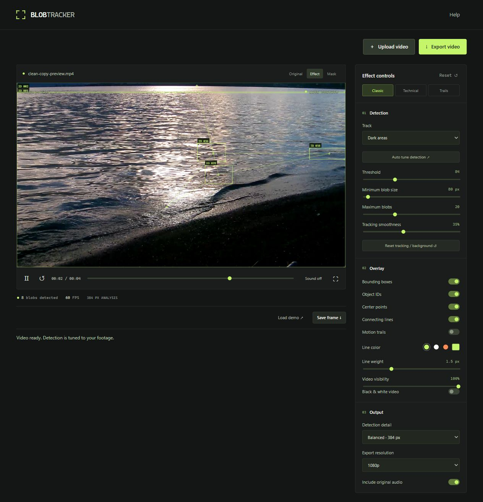

# Blob Tracker Studio

A browser tool for a TouchDesigner-style blob tracking overlay. Drop in a video, tune detection, and export boxes, persistent IDs, center points, connections and trails.

The preview above uses real uploaded footage processed in the browser.

## Run locally

Download [blob-tracker.html](blob-tracker.html) and double-click it to open in Chrome or Edge. Everything needed for the interface, tracker, and export is included in this one file. No Node.js, installation, API key, or server is required.

Compatible videos work offline. Unsupported codecs such as Motion JPEG MOV need an internet connection to download the browser conversion engine (31 MB). Conversion still runs on your device; your video is never sent to an external service.

Developers can optionally run `node server.mjs` and open http://127.0.0.1:5173 for faster native conversion. Rebuild the standalone file after editing `dist/` with `npm run build:standalone`; the generated HTML is committed so users do not need a build step.

## Use

1. Upload or drag in your video. Unsupported codecs are converted automatically.
2. Select Bright areas, Dark areas, or Moving areas. Motion detection works best with a static camera.
3. Open Detection mask and tune Threshold / Minimum blob size.
4. Adjust the overlay, then export video or save a PNG frame.

Processing stays on the device. Unsupported codecs (including Motion JPEG MOV) are converted automatically to H.264 / AAC MP4. The optional local server uses FFmpeg when installed; standalone and hosted copies use a single-thread WebAssembly worker. Browser conversion supports files up to 500 MB; the local helper up to 1 GB. Conversion preserves the aspect ratio and prepares footage at up to 1080p. Compatible source clips do not need conversion.

For native local conversion, install `imageio-ffmpeg` into `.local-tools/python` with `python -m pip install --target .local-tools/python imageio-ffmpeg`. The bundled Windows executable is discovered automatically. The original video is untouched and temporary conversion files are removed after the response. `BLOB_TRACKER_FFMPEG` can point to another installed FFmpeg executable.

Uploads are checked for decoded video dimensions, so an audio-only playback success cannot produce a black export with stale demo tracking. Detection is automatically tuned on upload; Original / Effect / Mask views make the source and output easy to compare.

Video export runs at playback speed using the browser's MediaRecorder encoder, at up to 30 FPS. Keep the tab visible. The app offers MP4 if the browser supports it, otherwise WebM. Original audio is included through Web Audio when enabled. Export resolution can be 720p, 1080p, or original up to 4K, without upscaling the source.

Detection uses luminance or background difference, connected components, and centroid matching. It is an artistic effect, not semantic object recognition. IDs can change on occlusion, overlap, large cuts or sudden motion. Higher Detection detail improves small blobs at the cost of processing speed.

The built-in animated demo runs through the same detector as uploaded footage.

## Verification

`npm test` checks detection, motion, noise filtering, ID matching, automatic tuning, and decoded-video validation. `npm run check` checks app and tracker syntax.
